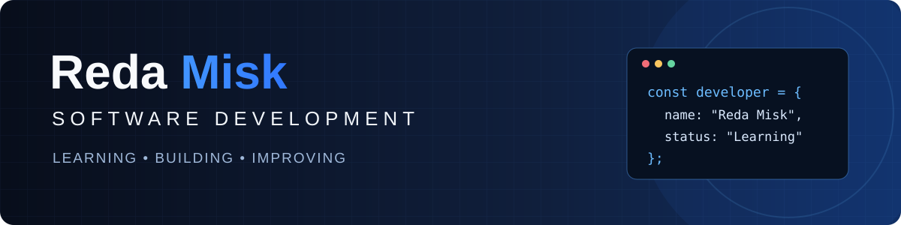

# Hi, I'm Reda Misk 👋

**Computer Science Student · Aspiring Software & Web Developer**

📍 Laval, Québec, Canada · 🎯 Interested in software and web development internships

---

## 👨‍💻 About Me

I'm a computer science student developing my skills in **software development and web development** through coursework and hands-on practice. I'm interested in object-oriented programming, databases, and building useful applications and websites.

I'm using GitHub to document what I learn and share real code as I complete projects.

## 🛠️ Technologies I'm Learning & Working With

**Programming and backend**

**Web development**

*These are technologies I'm studying or practicing—not a claim of professional expertise.*

## 🌱 Currently Focusing On

- Strengthening my programming and problem-solving skills
- Building responsive websites and understanding backend development
- Practicing object-oriented programming and working with databases
- Writing clearer, more maintainable code
- Learning Git and GitHub workflows

## 📂 Projects

I'm preparing my first public repositories. As I publish real projects, I'll add source code, setup instructions, screenshots where useful, and notes on what I learned.

## 🎯 Goals

I'm looking for opportunities to learn from a development team and gain practical experience through **software development or web development internships**.

---

**Learning · Building · Improving**

[GitHub Profile](https://github.com/redamisk05)

